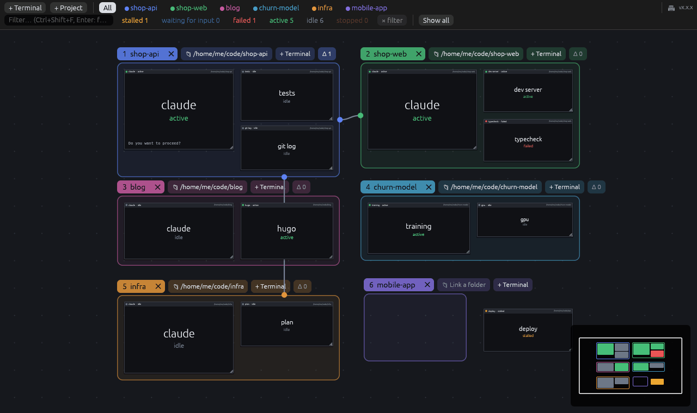
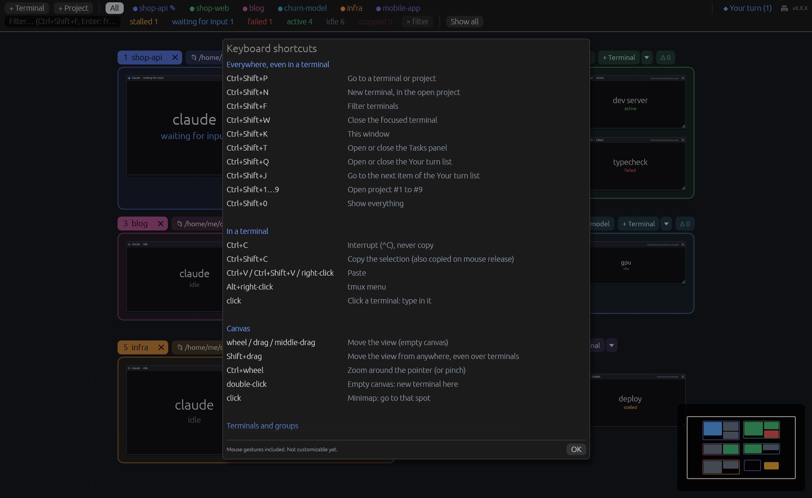
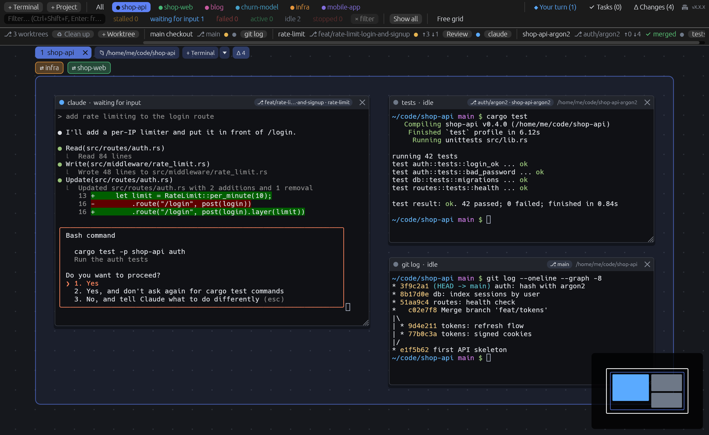
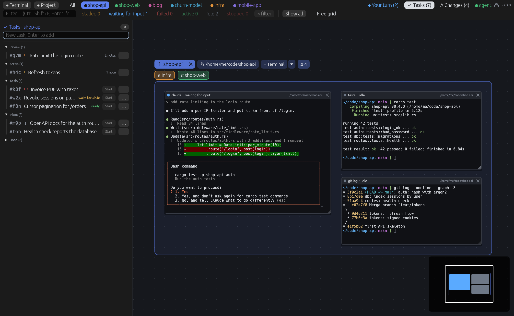
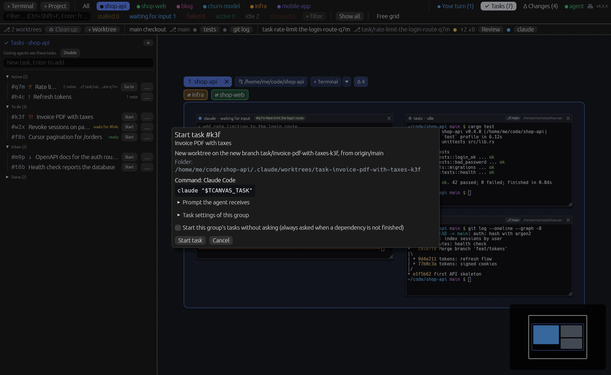
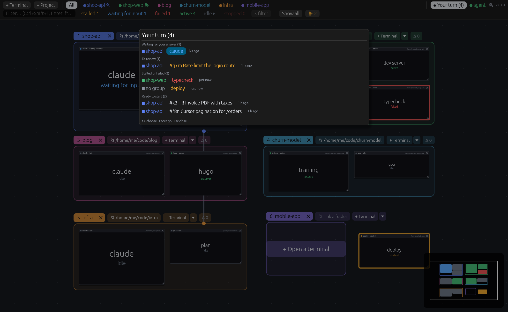
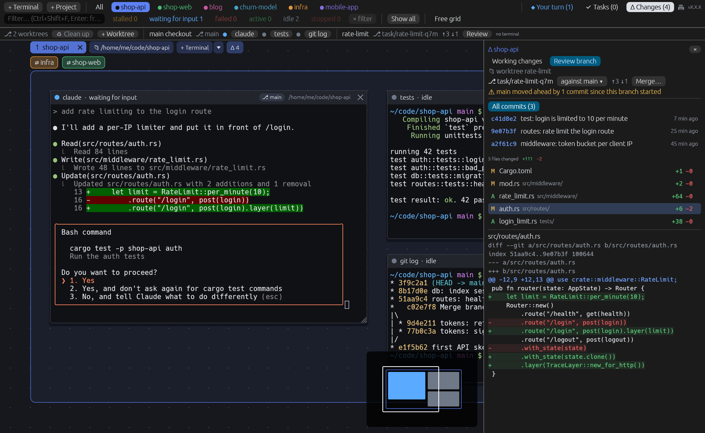

# tcanvas

[](https://github.com/sasselin/tcanvas/actions/workflows/ci.yml)
[](https://github.com/sasselin/tcanvas/releases/latest)
[](https://github.com/sasselin/tcanvas/releases)
%20%7C%20Linux-informational)
[](#license)

All your WSL terminals on an **infinite canvas**, Figma- or Miro-style. No more tabs: every
terminal is a card you can move and resize. Group them by project, filter them, jump straight to
the one you need, and get notified when one of them gets stuck.
A project linked to a folder shows **changed files and their diffs live**, which makes it ideal
for watching what Claude (or any other AI agent) is doing while it works. For git projects it
also keeps the **worktrees** your agents work in, a **task list** they can read and add to, a
**"Your turn"** list of what needs you, and a **review and merge** of the branches they produce.

- Native Windows app (`tcanvas.exe`, Rust + egui/wgpu, terminal emulation by `alacritty_terminal`),
  also available as a native Linux app (tmux runs locally, no WSL involved).
- Every card is a **tmux** session inside WSL: close the app and your terminals keep running;
  reopen it and everything is still there.
- A small Linux agent (`tcanvas-agent`) watches the terminals and reports when one is "stalled",
  "waiting for input", "failed" or "finished", and tracks file changes in linked folders.
- The interface is in English or French, following the Windows display language
  (set `TCANVAS_LANG=en` or `TCANVAS_LANG=fr` to override; any language other than French
  falls back to English).




## Features

- **Infinite canvas**: pan, zoom around the cursor, minimap, smooth camera flights. Zoomed out,
  cards turn into readable previews (title, status, last lines).
- **Projects as spaces**: each project is its own canvas, opened from a chip in the top bar or
  with `Ctrl+Shift+1`…`9`; **All** shows every project at once.
- **Groups that fit their terminals**: the frame always wraps its cards, drag and drop moves
  terminals between groups, and nothing ever overlaps.
- **Linked folder**: new terminals in a group open in its folder, picked with a WSL folder browser.
- **Live changes**: modified files, their diffs against `HEAD`, and the branch's recent commits.
- **Free grid**: inside a group, use the whole canvas: no frame, the group's label becomes a bar
  pinned at the top left, and terminals stay in the group wherever they are dropped.
- **Status and notifications**: stalled, waiting for input, failed, long command finished,
  terminal stopped, as in-app toasts, desktop notifications when the window is in the background
  (Windows toasts, D-Bus on Linux) and a pulsing border on the card.
- **Status filters, text filter and a "go to" palette** across all projects.
- **Wires between groups** to show how projects relate (an API and its front end, the infra they
  run on); a click flies to the other group. Inside a project's space, every group reachable
  through its wires (the whole chain) shows as a `⇄ name` chip in one row under the label.
- **Clipboard** like Windows Terminal: selection copied on release, right-click or
  `Ctrl+Shift+V` to paste. Pasting an image (a screenshot...) saves it as a PNG and pastes its
  path, which coding agents such as Claude Code turn into an attachment.
- **Clean shutdown**: closing a terminal really stops its shell and every process it started.
  A terminal whose session ended offers **Restart** or **Remove**.
- **Coding agents at a glance**: with the hooks installed, a coding agent's card shows its last
  prompt in its title bar, and says when the agent waits for you.
- **Commands and messages**: per group, command templates that open a terminal running a command,
  and quick messages typed into a terminal from its menu.
- **Worktrees**: a strip lists the open repository's worktrees and the terminals in each; cards
  show their branch; create a worktree from a group, with a per-repository recipe
  (`.tcanvas.toml`), and clean up merged ones.
- **Tasks**: a task list per project, kept outside the repository, that coding agents can read
  and add to; **Start** runs a task in its own worktree with a coding agent, and its status follows
  the agent.
- **"Your turn"**: one list, across every project, of the questions, reviews, alerts and ready
  tasks waiting for you.
- **Review and merge**: review a whole branch against its base, then merge it from the app,
  prepared aside and applied by a fast-forward. Nothing is ever pushed.
- **Persistent layout**: cards, groups, wires, the open project, the view and the free grid
  option are saved.
- **Updates from the app**: a new release shows a toast and an **Update** button with its
  release notes; one click downloads it, checks it against `SHA256SUMS`, swaps the binaries and
  restarts (terminals keep running). After an update, "What's new" lists the changes. Click the
  version at the right end of the toolbar to read them again (development builds show the commits
  since the last release, e.g. `0.1.1+3-gd44468c`). `TCANVAS_NO_UPDATE_CHECK=1` turns the check off.





## Install

### Windows

Requires WSL with a Linux distribution (`wsl --install` in PowerShell) and, inside it,
`tmux` ≥ 3.0 (`sudo apt install tmux`; the app says so if it is missing). Any shell works.

- **winget** (recommended; `winget upgrade` keeps it up to date):
  ```powershell
  winget install sasselin.tcanvas
  ```
- **Installer**: download `tcanvas-<version>-setup-x64.exe` from the
  [latest release](https://github.com/sasselin/tcanvas/releases/latest). It installs for the
  current user (no admin rights), adds a Start menu entry and an uninstaller. The installer is not
  signed yet, so SmartScreen may warn: **More info** > **Run anyway**.
- **Portable**: `tcanvas.exe` from the same page, run it from anywhere.

The exe is self-contained: it embeds a static Linux build of the agent and installs it into the
default WSL distro on startup (`~/.local/bin/tcanvas-agent`), updating it whenever the exe
changes.

### Linux

Requires `tmux` ≥ 3.0 and a Wayland or X11 desktop (X11 also needs `libxkbcommon-x11`).
Download `tcanvas-<version>-linux-x86_64.tar.gz` from the
[latest release](https://github.com/sasselin/tcanvas/releases/latest), then:

```sh
tar xzf tcanvas-*-linux-x86_64.tar.gz && cd tcanvas-*-linux-x86_64 && ./install.sh
```

It copies `tcanvas` and `tcanvas-agent` to `~/.local/bin` and adds a menu entry;
`./install.sh --uninstall` removes them. Running `./tcanvas` from the extracted folder works too.

### Verify a download (optional)

Every release file is built by this repository's CI, with a build attestation and a line in
`SHA256SUMS`:

```sh
gh attestation verify tcanvas-<version>-setup-x64.exe -R sasselin/tcanvas
```

### Hooks

Optional. Click **Install** next to "⚠ hooks" in the status bar, or in a terminal (in WSL on Windows):

```sh
tcanvas-agent install-hooks      # shell hooks + coding agent hooks
tcanvas-agent uninstall-hooks    # removes the coding agent hooks
```

- **Shell hooks**, for **bash** (≥ 5.0) or **zsh**: command exit codes and durations. One line
  is added to `~/.bashrc` or `~/.zshrc` (following `$SHELL`).
- **Coding agent hooks**, for the agents found in your home: Claude Code
  (`~/.claude/settings.json`), Codex (`~/.codex/hooks.json`, approve them once with `/hooks`),
  Gemini CLI (`~/.gemini/settings.json`), Copilot CLI (`~/.copilot/hooks/tcanvas.json`) and
  Qwen Code (`~/.qwen/settings.json`). They run `tcanvas-agent hook <event>`, so a card shows
  "waiting for input" as soon as the agent finishes its turn or asks for a permission. Your
  own settings and hooks are kept, and the original file is saved as `*.tcanvas.bak`. Outside
  tcanvas the hook exits at once and does nothing. Without these hooks, a known coding agent
  is shown as waiting after a few seconds without screen output. They also give a card its
  agent's last prompt, and let a started task's status follow its agent.

The **task integration** is a separate opt-in: **Enable** in the Tasks panel, or
`tcanvas-agent install-hooks --tasks` (`uninstall-hooks --tasks` removes it). For each coding
agent found it adds a session start hook that hands the agent the project's open tasks
(`tcanvas-agent task prime`), and for Claude Code and Codex a `tcanvas-tasks` skill describing the
`tcanvas-agent task` commands (`~/.claude/skills/`, `~/.agents/skills/`). A skill file you edited
is never overwritten nor removed.

### Building from source

Windows exe (cross-compiled from WSL or Linux):

```sh
rustup target add x86_64-pc-windows-gnu x86_64-unknown-linux-musl
sudo apt install mingw-w64
cargo build --release --target x86_64-pc-windows-gnu -p tcanvas
# → target/x86_64-pc-windows-gnu/release/tcanvas.exe (the musl agent is built and embedded by build.rs)
sudo apt install nsis              # optional: the installer
makensis -DVERSION=0.0.0 -DEXE="$PWD/target/x86_64-pc-windows-gnu/release/tcanvas.exe" installer/tcanvas.nsi
```

Linux app (the agent must sit next to it or be in the `PATH`):

```sh
cargo build --release -p tcanvas -p tcanvas-agent
./target/release/tcanvas
```

Agent commands: `tcanvas-agent` (server mode, used by the app), `tcanvas-agent install-hooks
[--tasks]`, `tcanvas-agent uninstall-hooks [--tasks]`, `tcanvas-agent hook <event>` (called by
coding agent hooks), `tcanvas-agent hooks [bash|zsh]` (print the hooks without installing them),
`tcanvas-agent kill <session>` (stop every process of a session, then the session itself), and
`tcanvas-agent task <command>` (the current project's task list, see [Tasks](#tasks)).

## Usage

| Gesture | Effect |
|---|---|
| Double-click on empty canvas | New terminal here (in the project under the cursor) |
| **+ Terminal** in the top bar | New terminal in the open project (`Ctrl+Shift+N`) |
| **+ Project** in the top bar | New empty project (group) |
| **+ Terminal** next to a group's label · big button in the middle of an empty group | New terminal in that group (in its linked folder), placed next to the others |
| **▾** next to a group's **+ Terminal** | A plain shell, one of the group's command templates, **Edit templates…**, **⎇ New worktree…** (git folders) |
| Drag empty canvas · middle-click drag | Pan the view (closed hand) |
| **Hold Shift** · Shift + drag | Hand tool: pan from anywhere, even over a terminal |
| Mouse wheel · Ctrl + wheel | Scroll · zoom around the cursor |
| Click a card | Give it the keyboard (a zoomed-out preview card flies in so you can type) |
| Drag the title bar · bottom-right corner | Move · resize (the terminal follows) |
| Drop a terminal **on a group's frame** · **outside any frame** | It joins that group · it leaves its group (red dashes while dragging) |
| Right-click the title bar → **Move to** | Send the terminal to another group (or out of any group), even from a space where the others are hidden |
| Double-click the title bar | Center and zoom on the card |
| **×** on the title bar | Close the terminal after confirmation: the shell and **all** its processes |
| Right-click the title bar | Rename, delay before "stalled", center and zoom, move to, **send a message** (the group's quick messages), close |
| Right-click inside a terminal · Alt + right-click | Paste · tmux's own menu |
| **Alt + drag** from a group's label onto another group | Link the two groups with a **wire** |
| Click a wire · right-click | Fly to the other group · delete the wire |
| Click a linked-group chip (`⇄ web`) in a project's space | Open that group's space |
| **Free grid** in the top bar (inside a group) | Toggle the free grid: no frame, the whole canvas belongs to the open group |
| Click the minimap | Go there |
| Group label: drag · **double-click** · right-click | Move it with its cards · **rename in place** (Enter confirms, Esc cancels) · menu: new terminal here, new worktree (git folders), rename, linked folder, color, remove the frame (keep the terminals), close the group |
| **×** on a group's label | Close the group **and all its terminals**, after confirmation (lists the running commands) |
| **📁** next to the label | **Link a folder**: a picker that browses WSL (breadcrumb, ⌂, ⬆, recent folders, filter, ⎇ git marker, editable path), opened on the folder of one of the group's terminals; **Unlink** removes it |
| **Δ n** next to a linked group's label | Number of uncommitted files; opens the Changes panel (also from **All**) |
| **Δ Changes** (top bar, linked group open) | Panel of changed files, recent commits and their diffs, live |
| A project's chip in the top bar | **Open that project alone**, framed and centered in one click: the other projects are hidden (🔔 = a terminal there needs attention, ✎ = files are being written there) |
| **All** chip | Overview of every project, for organizing |
| **🔔 n** in the top bar | Go to the next terminal that needs attention |
| **◆ Your turn (n)** in the top bar | The list of what needs you, across every project (`Ctrl+Shift+Q`) |
| **✔ Tasks (n)** in the top bar (linked group open) | The group's task panel (`Ctrl+Shift+T`) |
| Worktree strip (under the top bar) | A terminal's chip: go to it · **Review**: review that branch · **+ Worktree** · **♻ Clean up** |

Global shortcuts (they work even when a terminal has the keyboard):

| Shortcut | Effect |
|---|---|
| `Ctrl+Shift+1` … `9` | Open project 1 to 9 (number shown on its label; physical keys, so AZERTY works too) |
| `Ctrl+Shift+P` | "Go to" palette: terminals **and projects** from every space (opens the right project) |
| `Ctrl+Shift+N` | New terminal |
| `Ctrl+Shift+W` | Close the focused terminal (confirmation: Enter closes, Esc cancels) |
| `Ctrl+Shift+F` | Filter (Enter: frame the matches) |
| `Ctrl+Shift+0` | Show all (in the open space) |
| `Ctrl+Shift+T` | Open or close the Tasks panel |
| `Ctrl+Shift+Q` | Open or close the "Your turn" list (↑↓ choose, Enter go, Esc close) |
| `Ctrl+Shift+J` | Go to the next item of the "Your turn" list, without opening it |
| `Ctrl+Shift+K` | Every shortcut and mouse gesture (also the ⌨ button of the top bar, or the "Go to" palette) |

Ctrl+C, Ctrl+K, Ctrl+P, Ctrl+plus/minus, Esc, Tab… go to the terminal. Ctrl+V and `Ctrl+Shift+V` paste (an image pastes the path of a saved PNG).
A mouse selection (in tmux) is copied to the system clipboard; `Ctrl+Shift+C` never sends ^C.

**Spaces**: each project is a separate canvas. Only one is visible at a time; a terminal created
while a project is open belongs to it. Terminals outside any project only appear in **All**.
A project always opens framed on its whole content; **All** restores the overview you left.
The open project and the view are saved. With **Free grid** on, a group's space has no frame:
its label is a bar pinned at the top left (rename, folder, new terminal, changes, close) and a
terminal dropped anywhere stays in the group.

**Nothing overlaps**: a growing group pushes neighboring groups (and their terminals) aside;
a terminal outside any group, dropped or created against a frame, jumps to the nearest free spot;
inside a group, the dropped terminal keeps its place and its neighbors move aside.

**Mouse wheel**: it scrolls whatever is under the pointer (terminal, even without the keyboard,
panel, list, menu, window) and only pans the view over empty canvas.

**Filter**: the status chips count the terminals of the open space. A click keeps only that status
and frames the view on its terminals (Ctrl+click: combine); click again, or **× filter**, to remove
the filter and return to the previous view. Other terminals are dimmed, never hidden.

**Groups**: a terminal belongs to one group, and the group's frame **always wraps its terminals**
(it grows and shrinks with them). While you drag a terminal, its group's frame stays put: drop it
outside to take it out of the group, drop it on another frame to move it there. With **Free grid**
on, the frame is never frozen and a terminal dropped anywhere stays in the open group.

**Linked folder and changes**: new terminals in a linked group open in its folder. The agent scans
the folder every 2 s (`git status` + `git diff HEAD`, untracked files included, without ever
locking the index). The **Δ Changes** panel lists uncommitted files, most recent first, with
`+/−` counts; files touched in the last few seconds are highlighted. Below them, the branch's
recent commits; click a file or a commit to see its diff. With **Follow** (on by default), the
diff of the latest modified file or commit shows up on its own; clicking a file or a commit
stops following.
A ✎ on another project's chip means files are being written there right now. Outside git: list
of files modified since tracking started, without diffs.

**Closing**: `tcanvas-agent kill` really stops everything: the shells' descendants, processes from
the same session (`nohup`), and those that detached (`setsid`, daemons), found through their
`TMUX_PANE`. SIGHUP + SIGTERM first, SIGKILL for the stubborn ones, then a check that nothing is
left.

**Notifications**: a toast in the app and a pulsing border on the card (plus a desktop
notification, Windows toast or D-Bus on Linux, when the window is in the background) when a
terminal is stalled
(no output for 60 s with an idle CPU; adjustable per card), waits for an answer (`[y/N]`,
`password:`…), fails (exit code ≠ 0, except Ctrl+C), finishes a command that took more than 30 s,
or stops. Nothing if you are already looking at that terminal. In-app notices also confirm a
copy, or that a terminal moved to another group (click: go there), without any alert.

The icon (`assets/icon.svg`, with an `icon-small.svg` variant for 16–32 px) is embedded in the
Windows exe (`crates/app/build.rs`, `embed-resource` + mingw-w64's `windres`) and in the window.
To regenerate the PNGs and the ICO: `sudo apt install librsvg2-bin imagemagick`, then
`rsvg-convert -w N` and `convert icon-*.png icon.ico`.

## Worktrees, tasks and reviews

Coding agents work best on their own branch, in their own folder. tcanvas keeps those folders
(git worktrees) in view, gives each project a task list the agents share, tells you whose turn it
is, and lets you review and merge what they did. Everything here is local: nothing is pushed or
fetched.

### Command templates and quick messages

The **▾** next to a group's **+ Terminal** opens a terminal that runs one of the group's
**command templates** (`claude`, `npm run dev`...): the command runs once, through your shell, in
the group's folder, and the shell stays when it ends. **Quick messages** are a group's canned
texts ("Commit your changes with a clear message"): right-click a terminal's title bar, **Send a
message**, and the text is typed into that terminal as one paste, followed by Enter if the message
asks for it.

### Worktrees



When the open group's repository has more than its main checkout, a strip under the top bar lists
its worktrees: folder, branch, uncommitted changes (●), commits ahead of and behind the default
branch (↑↓), **✔ merged**, and the terminals working in each (click one to go there). Every card
shows its branch in a badge (with the worktree's folder when it is not the main checkout).

- **+ Worktree** (in the strip, or **⎇ New worktree…** in the group's menus) creates a worktree on
  a new or an existing branch, from the default branch or another base, in
  `.claude/worktrees/<name>` by default (the location is editable and kept per group), applies the
  repository's recipe (below) and opens a terminal there, a shell or one of the group's templates.
  When git does not ignore that folder, the dialog offers to add it to `.git/info/exclude`.
- **♻ Clean up** lists what can go: worktrees whose branch is merged into the default branch, with
  no uncommitted or untracked change, no terminal and no program running in them, and merged
  branches without a worktree; everything else is listed as kept, with the reason. Removing asks
  for a confirmation that lists the folders, the branches and the ignored files that go with
  them (`.env`, build outputs, local databases...). Nothing is forced: git refuses if a change
  shows up meanwhile. Worktrees whose folder is already gone can be pruned.

#### Worktree recipe

A fresh worktree lacks what git does not check out (`.env`, installed
dependencies, a local database). A repository describes what a new worktree needs in
`.tcanvas.toml`, at the root of its main checkout (commit it to share it):

```toml
[worktree]
copy = [".env", "config/*.local"]   # copied (folders whole, permissions kept)
symlink = ["node_modules"]          # linked to the main checkout's copy
setup = "npm run db:seed"           # run in the new terminal, before the chosen command
```

The recipe is read from the main checkout's working tree as it is when the worktree is created,
not from the new branch. When the new-worktree dialog creates a worktree, the agent copies and
links right after `git worktree add`, and the dialog lists each pattern with what it matches
beforehand, then what was done (a path already in the worktree, such as a tracked file, is never
replaced). The new terminal opens once the copies and links are done, when it has a command to
run. The folders in the repository's Claude Code settings (`.claude/settings.json`,
`worktree.symlinkDirectories`) are linked too. Unknown keys are ignored; a malformed file, or one
that is not a regular file (a symbolic link, a FIFO), is reported and the worktree is still
created, without it.

- **Patterns** are relative to the main checkout: `*` and `?` within a path component, `**` for
  any number of folders, everything else literal. Wildcards skip hidden names unless the
  pattern starts with `.` (`.env*`), `**` skips hidden folders, and nothing ever matches `.git`,
  goes through a symbolic link or into another repository or worktree. Absolute paths, `~`, `..`,
  `.git`, `[ ] { }` and `\` are refused.
- **Copies** keep permissions, copy a symbolic link as a link when it points inside the main
  checkout (and skip it otherwise), and stop after 4 GB or 200,000 entries in all.
- **Links** are absolute (`<worktree>/node_modules -> <main checkout>/node_modules`), so they
  survive `git worktree move`. A linked folder is shared, writable state: installing dependencies
  in one worktree changes the main checkout's folder, and every worktree linked to it. Never a
  link to another repository or worktree, nor to a folder holding the new worktree. Removing the
  worktree deletes the link, never what it points to.
  For the cleanup window to offer such a worktree, git must ignore the link: write `node_modules`
  in `.gitignore`, not `node_modules/` (a trailing slash only matches real folders, and a link
  is not one); otherwise the link counts as an untracked file and the worktree is kept.
- **Setup** comes from the repository, so it never runs on its own: the dialog shows the whole
  command, and it runs only when **Run this setup command** is ticked. The tick starts off until
  you accepted that exact command for that repository once (remembered in tcanvas' own settings,
  as a hash; an edited command asks again). Acceptance covers the command text only:
  `setup = "./scripts/setup.sh"` accepted once keeps running after the script itself changes.
  Characters that would not show (escape sequences, bidirectional marks...) are spelled out in
  the dialog. It runs in the new terminal's shell, its output in the card; the chosen command
  runs after it only if it succeeded (its last command's status).

### Tasks



**✔ Tasks** in the top bar (`Ctrl+Shift+T`) opens the task list of the open group's project: a
title, a Markdown description, a priority, notes (yours or an agent's) and the tasks it waits for,
sorted by status: inbox, to do, active, review, done, canceled. A task whose dependencies are all
done is marked **ready**. Type a title in the panel to add a task to the inbox.

The list is kept **outside the repository**, in `~/.local/share/tcanvas/tasks/` (in WSL on
Windows; files only you can read): it is never committed, survives branch switches, and every
worktree of a repository shares one list (a folder outside git has its own).

Coding agents use it from their terminal with `tcanvas-agent task` (`list`, `show`, `add`, `note`,
`status`, `dep`; `tcanvas-agent task --help` lists them). They append, never rewrite: an agent can
read tasks, file new ones, add notes and dependencies, and move a task to active or review; it
cannot edit a title or a description, remove a task, or close one (done and canceled are yours,
in the panel). With the [task integration](#hooks) enabled, each new agent session starts with the
project's open tasks, and Claude Code and Codex get a skill describing these commands.

### Starting a task



**Start** on a task creates its worktree on a new branch (`task/<title>-<ref>`, from the default
branch; the prefix is a group setting), applies the recipe, and opens a card there that runs the
group's **task command**: the command template ticked **Starts the group's tasks**, chosen the
first time. A confirmation shows the branch, the folder, the command and the prompt the agent
receives (it can be skipped for the group, except when a dependency is not finished). Outside git,
the command runs in the group's folder. The task's card shows the task in its title bar; the
task's row offers **Go to**, or **Resume** once the card is closed. Cards that start tasks need a
bash or zsh login shell.

The task's text is data, never part of a command line. In the task command, `{task}` (the
prompt), `{task_ref}`, `{task_title}` and `{task_file}` (a file holding the prompt) are accepted
only as words of their own, outside quotes, and become quoted variables: `claude {task}` runs
`claude "$TCANVAS_TASK"`. Any other use is refused; write the variable yourself instead, e.g.
`bash -c 'claude "$TCANVAS_TASK"'`.

The task's status then **follows its agent** (with the coding agent hooks installed): a new prompt
moves it to active, and the end of a turn that committed, with the branch ahead of its base, moves
it to review. Nothing ever moves a task to done or canceled, and a status you set by hand stays
until the agent's next prompt.

### "Your turn"



**◆ Your turn** in the top bar (`Ctrl+Shift+Q`) is one list, across every project, of what needs
you: agents and terminals waiting for your answer, tasks in review, stalled or failed terminals
you have not looked at, then tasks ready to start. Up/Down and Enter go to a row;
`Ctrl+Shift+J` goes straight to the next one without opening the list. A question stays listed
until it is answered; the 🔔 button still counts every alert, a long command that finished
included.

### Review and merge



**Review** (in the worktree strip, on a task in review, or in the "Your turn" list) opens the
Changes panel in **Review branch** mode: the whole branch against its base (the default branch, or
another one), like a merge request: its commits, every file it changes with its diff, and a
warning when the base moved on since the branch started. Uncommitted changes of that worktree are
listed apart: they are not part of the branch.

**Merge…** merges the reviewed branch into its base, after a confirmation that says what will
happen. Choose a merge commit, a fast-forward when possible, a squash into one commit (with its
message) or a rebase then fast-forward; the choice is remembered per group.

- The result is **prepared aside**, in a private worktree of the agent; your worktrees are not
  touched while it is built. Only at the end is the base moved to it, in the worktree that has the
  base checked out, by a fast-forward that does all or nothing. The branch's worktree is never
  written.
- On a **conflict**, nothing is applied and the conflicting files are listed; open a terminal in
  the branch's worktree to resolve them (or let the agent do it), then review and merge again.
- **Nothing is pushed.** Commits use your own git identity (the app never makes one up), and git
  hooks run as usual. The merge is refused while a coding agent is working in the base's
  worktree, or when the branch or the base moved since the review.
- A **squash** or a **rebase** leaves the branch with its own commits, which git does not count as
  merged: the cleanup keeps that branch and its worktree, and the app tells you how to remove them
  by hand once you are sure. A rebase is refused when the branch has merge commits, and is checked
  to give the same files as a merge.
- After a merge, the app offers to remove the worktree (through the cleanup window and its own
  checks) and to move the linked task to done.

## Architecture

```
tcanvas.exe (Windows)                         WSL
  card ── ConPTY ── wsl.exe ── sh ── tmux -L tcanvas attach ──┐
  agent_link ── stdin/stdout JSON ── tcanvas-agent ──── tmux list-panes + /proc + git
```

The workspace is organized in **vertical slices**:

```
crates/protocol   app ⇄ agent messages (serde, one JSON line per message)
crates/agent      features/{serve, tmux, status, timing, hooks, agent_hooks, kill, send, changes,
                            worktrees, create, recipe, cleanup, review, merge,
                            tasks, task_cli, task_skill}
crates/app        shell/ (world, event bus, i18n, agent launch, theme, fonts, widgets, version)
                  features/{canvas, terminal_card, projects, spaces, changes, wires, worktrees,
                            tasks, queue, filters, jump, shortcuts, notifications, agent_link,
                            persistence, updates}
```

Slices never call each other: they read the `World` and emit `Event`s that the `shell`
dispatches to all of them.

The canvas is saved to `%APPDATA%\tcanvas\config\layout.json` (`~/.config/tcanvas/layout.json`
on Linux; atomic writes; an unreadable file
is set aside, never overwritten). Orphaned tmux sessions (`tc_*`) are adopted again automatically.

Useful variables: `TCANVAS_TMUX_SOCKET` (tmux socket, default `tcanvas`), `TCANVAS_CONFIG_DIR`,
`TCANVAS_AGENT` (path of the agent inside WSL; disables the self-installation), `TCANVAS_AGENT_BIN`
(build time: prebuilt agent to embed instead of building it), `TCANVAS_LANG` (`en` or `fr`),
`TCANVAS_NO_UPDATE_CHECK=1` (no update check).

## Development

Keep everything in sync while you work:

```sh
./scripts/deploy.sh              # once: build and install the Windows exe, restart the app
./scripts/deploy.sh --no-start   # same, without restarting the app
./scripts/watch.sh               # continuously: rebuild and restart on every code change
```

`deploy.sh` installs `tcanvas.exe` to `%USERPROFILE%\tcanvas`; on startup the exe updates the
agent in `~/.local/bin`.
If the build fails, the running app is left untouched. Restarting the app costs nothing: the
terminals live in tmux. Tip: run `watch.sh` in a tcanvas terminal itself; it survives the restarts
it triggers.

### Screenshots

The images in this README are rendered by the real app, headless, from
`crates/app/tests/screenshots.rs` (canned terminal output, no tmux needed). After any change that
alters what the UI looks like, regenerate them and commit the PNGs with the change:

```sh
./scripts/screenshots.sh         # writes docs/screenshots/*.png (software Vulkan via Mesa lavapipe)
```

## Tests

```sh
cargo test --workspace          # Linux: unit tests, headless UI, real end-to-end (tmux + PTY + agent)
./scripts/test-windows.sh       # the same suite built for Windows and run on Windows
                                # (real ConPTY + wsl.exe), from WSL
cargo clippy --workspace --all-targets
```

The end-to-end test opens a real terminal, types into it, checks the "stalled" status and the
notification, **closes and reopens the app** and checks that it is the same shell, then closes
the terminal. It also links a group to a temporary git repository, checks that a terminal from
the group opens there and that a file written from that terminal shows up in the changes. Other
end-to-end tests start a card with a command, send text to a session, apply a worktree recipe and
start a task in its own worktree. They use a throwaway tmux server, throwaway git repositories and
a scratch home, and never touch your sessions, repositories or settings.

## Contributing

See [CONTRIBUTING.md](CONTRIBUTING.md). Releases and the [changelog](CHANGELOG.md) are generated
from Conventional Commit messages.

## License

Licensed under either of [Apache License, Version 2.0](LICENSE-APACHE) or
[MIT license](LICENSE-MIT) at your option. Unless you explicitly state otherwise, any
contribution intentionally submitted for inclusion in tcanvas by you, as defined in the Apache-2.0
license, shall be dual licensed as above, without any additional terms or conditions.
