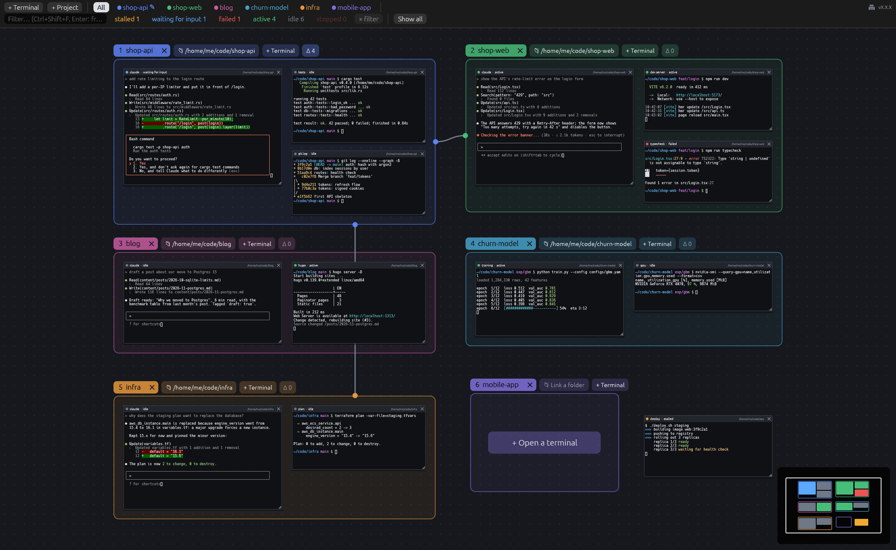
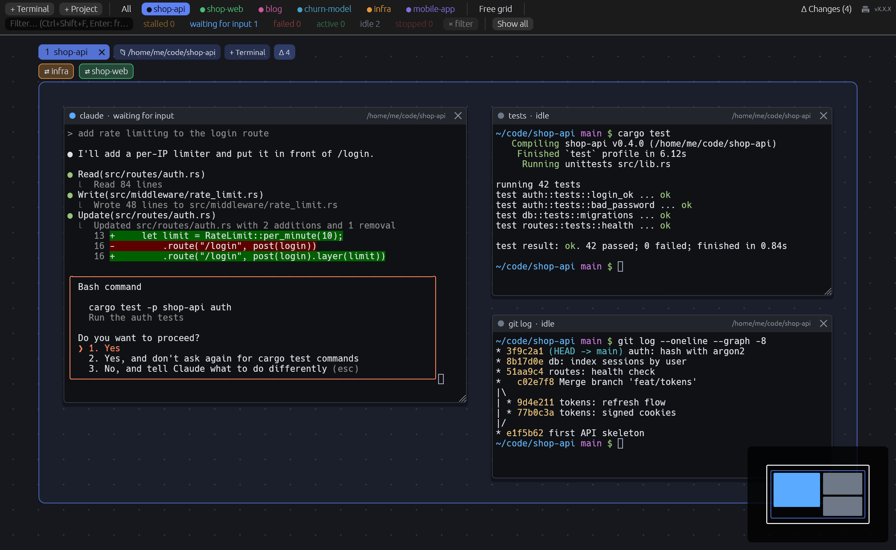
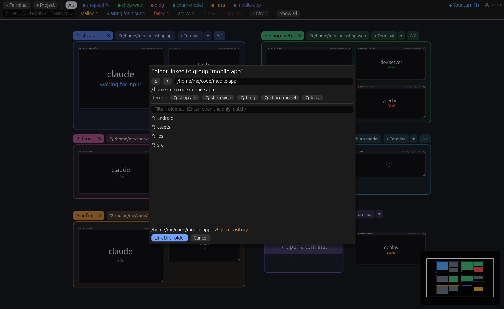
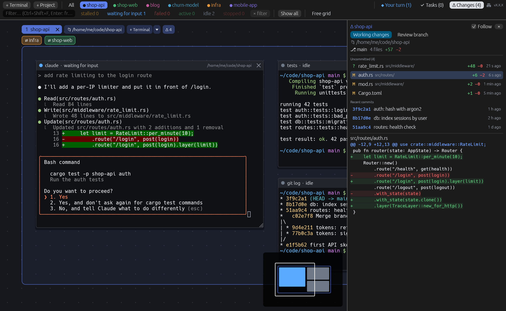
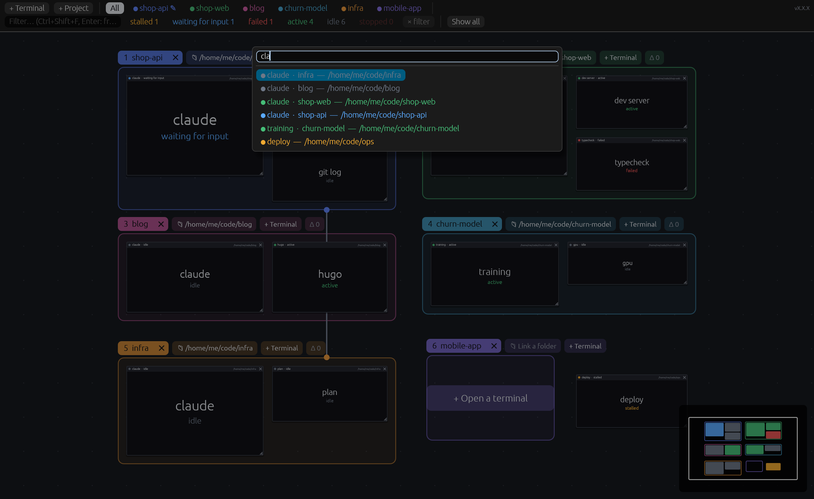
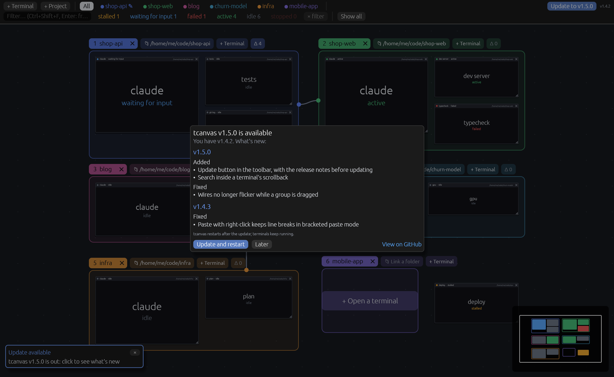

# tcanvas

All your WSL terminals on an **infinite canvas**, Figma- or Miro-style. No more tabs: every
terminal is a card you can move and resize. Group them by project, filter them, jump straight to
the one you need, and get notified when one of them gets stuck.
A project linked to a folder shows **changed files and their diffs live**, which makes it ideal
for watching what Claude (or any other AI agent) is doing while it works.

- Native Windows app (`tcanvas.exe`, Rust + egui/wgpu, terminal emulation by `alacritty_terminal`),
  also available as a native Linux app (tmux runs locally, no WSL involved).
- Every card is a **tmux** session inside WSL: close the app and your terminals keep running;
  reopen it and everything is still there.
- A small Linux agent (`tcanvas-agent`) watches the terminals and reports when one is "stalled",
  "waiting for input", "failed" or "finished", and tracks file changes in linked folders.
- The interface is in English or French, following the Windows display language
  (set `TCANVAS_LANG=en` or `TCANVAS_LANG=fr` to override; any language other than French
  falls back to English).



## Features

- **Infinite canvas**: pan, zoom around the cursor, minimap, smooth camera flights. Zoomed out,
  cards turn into readable previews (title, status, last lines).
- **Projects as spaces**: each project is its own canvas, opened from a chip in the top bar or
  with `Ctrl+Shift+1`…`9`; **All** shows every project at once.
- **Groups that fit their terminals**: the frame always wraps its cards, drag and drop moves
  terminals between groups, and nothing ever overlaps.
- **Linked folder**: new terminals in a group open in its folder, picked with a WSL folder browser.
- **Live changes**: modified files, their diffs against `HEAD`, and the branch's recent commits.
- **Status and notifications**: stalled, waiting for input, failed, long command finished,
  terminal stopped, as Windows toasts and a pulsing border on the card.
- **Status filters, text filter and a "go to" palette** across all projects.
- **Wires between groups** to show how projects relate (an API and its front end, the infra they
  run on); a click flies to the other group. Inside a project's space, linked groups show as
  chips on the side of the frame that open them.
- **Clipboard** like Windows Terminal: selection copied on release, right-click or
  `Ctrl+Shift+V` to paste.
- **Clean shutdown**: closing a terminal really stops its shell and every process it started.
- **Persistent layout**: cards, groups, wires, the open project and the view are saved.
- **Updates from the app**: a new release shows a toast and an **Update** button with its
  release notes; one click downloads it, checks it against `SHA256SUMS`, swaps the binaries and
  restarts (terminals keep running). After an update, "What's new" lists the changes. Click the
  version in the toolbar to read them again. `TCANVAS_NO_UPDATE_CHECK=1` turns the check off.











## Install

### Windows

Requires WSL with a Linux distribution (`wsl --install` in PowerShell) and, inside it,
`tmux` ≥ 3.0 (`sudo apt install tmux`; the app says so if it is missing). Any shell works.

- **winget** (recommended; `winget upgrade` keeps it up to date):
  ```powershell
  winget install sasselin.tcanvas
  ```
- **Installer**: download `tcanvas-<version>-setup-x64.exe` from the
  [latest release](https://github.com/sasselin/tcanvas/releases/latest). It installs for the
  current user (no admin rights), adds a Start menu entry and an uninstaller. The installer is not
  signed yet, so SmartScreen may warn: **More info** > **Run anyway**.
- **Portable**: `tcanvas.exe` from the same page, run it from anywhere.

The exe is self-contained: it embeds a static Linux build of the agent and installs it into the
default WSL distro on startup (`~/.local/bin/tcanvas-agent`), updating it whenever the exe
changes.

### Linux

Requires `tmux` ≥ 3.0 and a Wayland or X11 desktop (X11 also needs `libxkbcommon-x11`).
Download `tcanvas-<version>-linux-x86_64.tar.gz` from the
[latest release](https://github.com/sasselin/tcanvas/releases/latest), then:

```sh
tar xzf tcanvas-*-linux-x86_64.tar.gz && cd tcanvas-*-linux-x86_64 && ./install.sh
```

It copies `tcanvas` and `tcanvas-agent` to `~/.local/bin` and adds a menu entry;
`./install.sh --uninstall` removes them. Running `./tcanvas` from the extracted folder works too.

### Verify a download (optional)

Every release file is built by this repository's CI, with a build attestation and a line in
`SHA256SUMS`:

```sh
gh attestation verify tcanvas-<version>-setup-x64.exe -R sasselin/tcanvas
```

### Shell hooks

Optional, for command exit codes and durations: the shell hooks, for **bash** (≥ 5.0) or
**zsh**. Click **Install** next to "⚠ shell hooks" in the status bar, or in a terminal (in WSL on Windows):

```sh
tcanvas-agent install-hooks      # adds one line to ~/.bashrc or ~/.zshrc (following $SHELL)
```

### Building from source

Windows exe (cross-compiled from WSL or Linux):

```sh
rustup target add x86_64-pc-windows-gnu x86_64-unknown-linux-musl
sudo apt install mingw-w64
cargo build --release --target x86_64-pc-windows-gnu -p tcanvas
# → target/x86_64-pc-windows-gnu/release/tcanvas.exe (the musl agent is built and embedded by build.rs)
sudo apt install nsis              # optional: the installer
makensis -DVERSION=0.0.0 -DEXE="$PWD/target/x86_64-pc-windows-gnu/release/tcanvas.exe" installer/tcanvas.nsi
```

Linux app (the agent must sit next to it or be in the `PATH`):

```sh
cargo build --release -p tcanvas -p tcanvas-agent
./target/release/tcanvas
```

Agent commands: `tcanvas-agent` (server mode, used by the app), `tcanvas-agent install-hooks`,
`tcanvas-agent hooks [bash|zsh]` (print the hooks without installing them), and
`tcanvas-agent kill <session>` (stop every process of a session, then the session itself).

## Usage

| Gesture | Effect |
|---|---|
| Double-click on empty canvas | New terminal here (in the project under the cursor) |
| **+ Terminal** in the top bar | New terminal in the open project (`Ctrl+Shift+N`) |
| **+ Project** in the top bar | New empty project (group) |
| **+ Terminal** next to a group's label · big button in the middle of an empty group | New terminal in that group (in its linked folder), placed next to the others |
| Drag empty canvas · middle-click drag | Pan the view (closed hand) |
| **Hold Shift** · Shift + drag | Hand tool: pan from anywhere, even over a terminal |
| Mouse wheel · Ctrl + wheel | Scroll · zoom around the cursor |
| Click a card | Give it the keyboard (a zoomed-out preview card flies in so you can type) |
| Drag the title bar · bottom-right corner | Move · resize (the terminal follows) |
| Drop a terminal **on a group's frame** · **outside any frame** | It joins that group · it leaves its group (red dashes while dragging) |
| Right-click the title bar → **Move to** | Send the terminal to another group (or out of any group), even from a space where the others are hidden |
| Double-click the title bar | Center and zoom on the card |
| **×** on the title bar | Close the terminal after confirmation: the shell and **all** its processes |
| Right-click the title bar | Rename, delay before "stalled", center and zoom, move to, close |
| Right-click inside a terminal · Alt + right-click | Paste · tmux's own menu |
| **Alt + drag** from a group's label onto another group | Link the two groups with a **wire** |
| Click a wire · right-click | Fly to the other group · delete the wire |
| Click a linked-group chip (`→ web`) in a project's space | Open that group's space |
| Click the minimap | Go there |
| Group label: drag · **double-click** · right-click | Move it with its cards · **rename in place** (Enter confirms, Esc cancels) · menu: new terminal here, rename, linked folder, color, remove the frame (keep the terminals), close the group |
| **×** on a group's label | Close the group **and all its terminals**, after confirmation (lists the running commands) |
| **📁** next to the label | **Link a folder**: a picker that browses WSL (breadcrumb, ⌂, ⬆, recent folders, filter, ⎇ git marker, editable path), opened on the folder of one of the group's terminals; **Unlink** removes it |
| **Δ n** next to a linked group's label | Number of uncommitted files; opens the Changes panel (also from **All**) |
| **Δ Changes** (top bar, linked group open) | Panel of changed files, recent commits and their diffs, live |
| A project's chip in the top bar | **Open that project alone**, framed and centered in one click: the other projects are hidden (🔔 = a terminal there needs attention, ✎ = files are being written there) |
| **All** chip | Overview of every project, for organizing |
| **🔔 n** in the top bar | Go to the next terminal that needs attention |

Global shortcuts (they work even when a terminal has the keyboard):

| Shortcut | Effect |
|---|---|
| `Ctrl+Shift+1` … `9` | Open project 1 to 9 (number shown on its label; physical keys, so AZERTY works too) |
| `Ctrl+Shift+P` | "Go to" palette: terminals **and projects** from every space (opens the right project) |
| `Ctrl+Shift+N` | New terminal |
| `Ctrl+Shift+W` | Close the focused terminal (confirmation: Enter closes, Esc cancels) |
| `Ctrl+Shift+F` | Filter (Enter: frame the matches) |
| `Ctrl+Shift+0` | Show all (in the open space) |

Ctrl+C, Ctrl+K, Ctrl+P, Ctrl+plus/minus, Esc, Tab… go to the terminal. Ctrl+V and `Ctrl+Shift+V` paste.
A mouse selection (in tmux) is copied to the Windows clipboard; `Ctrl+Shift+C` never sends ^C.

**Spaces**: each project is a separate canvas. Only one is visible at a time; a terminal created
while a project is open belongs to it. Terminals outside any project only appear in **All**.
A project always opens framed on its whole content; **All** restores the overview you left.
The open project and the view are saved.

**Nothing overlaps**: a growing group pushes neighboring groups (and their terminals) aside;
a terminal outside any group, dropped or created against a frame, jumps to the nearest free spot;
inside a group, the dropped terminal keeps its place and its neighbors move aside.

**Mouse wheel**: it scrolls whatever is under the pointer (terminal, even without the keyboard,
panel, list, menu, window) and only pans the view over empty canvas.

**Filter**: the status chips count the terminals of the open space. A click keeps only that status
and frames the view on its terminals (Ctrl+click: combine); click again, or **× filter**, to remove
the filter and return to the previous view. Other terminals are dimmed, never hidden.

**Groups**: a terminal belongs to one group, and the group's frame **always wraps its terminals**
(it grows and shrinks with them). While you drag a terminal, its group's frame stays put: drop it
outside to take it out of the group, drop it on another frame to move it there.

**Linked folder and changes**: new terminals in a linked group open in its folder. The agent scans
the folder every 2 s (`git status` + `git diff HEAD`, untracked files included, without ever
locking the index). The **Δ Changes** panel lists uncommitted files, most recent first, with
`+/−` counts; files touched in the last few seconds are highlighted. Below them, the branch's
recent commits; click a file or a commit to see its diff. With **Follow** (on by default), the
diff of the latest modified file or commit shows up on its own; clicking a file stops following.
A ✎ on another project's chip means files are being written there right now. Outside git: list
of files modified since tracking started, without diffs.

**Closing**: `tcanvas-agent kill` really stops everything: the shells' descendants, processes from
the same session (`nohup`), and those that detached (`setsid`, daemons), found through their
`TMUX_PANE`. SIGHUP + SIGTERM first, SIGKILL for the stubborn ones, then a check that nothing is
left.

**Notifications**: a Windows toast (and a pulsing border on the card) when a terminal is stalled
(no output for 60 s with an idle CPU; adjustable per card), waits for an answer (`[y/N]`,
`password:`…), fails (exit code ≠ 0, except Ctrl+C), finishes a command that took more than 30 s,
or stops. Nothing if you are already looking at that terminal.

The icon (`assets/icon.svg`, with an `icon-small.svg` variant for 16–32 px) is embedded in the
Windows exe (`crates/app/build.rs`, `embed-resource` + mingw-w64's `windres`) and in the window.
To regenerate the PNGs and the ICO: `sudo apt install librsvg2-bin imagemagick`, then
`rsvg-convert -w N` and `convert icon-*.png icon.ico`.

## Architecture

```
tcanvas.exe (Windows)                         WSL
  card ── ConPTY ── wsl.exe ── sh ── tmux -L tcanvas attach ──┐
  agent_link ── stdin/stdout JSON ── tcanvas-agent ──── tmux list-panes + /proc + git
```

The workspace is organized in **vertical slices**:

```
crates/protocol   app ⇄ agent messages (serde, one JSON line per message)
crates/agent      features/{tmux, status, hooks, kill, changes, serve}
crates/app        shell/ (world, event bus, i18n, agent launch, theme, fonts)
                  features/{canvas, terminal_card, projects, spaces, changes, wires,
                            filters, jump, notifications, agent_link, persistence}
```

Slices never call each other: they read the `World` and emit `Event`s that the `shell`
dispatches to all of them.

The canvas is saved to `%APPDATA%\tcanvas\config\layout.json` (atomic writes; an unreadable file
is set aside, never overwritten). Orphaned tmux sessions (`tc_*`) are adopted again automatically.

Useful variables: `TCANVAS_TMUX_SOCKET` (tmux socket, default `tcanvas`), `TCANVAS_CONFIG_DIR`,
`TCANVAS_AGENT` (path of the agent inside WSL; disables the self-installation), `TCANVAS_AGENT_BIN`
(build time: prebuilt agent to embed instead of building it), `TCANVAS_LANG` (`en` or `fr`).

## Development

Keep everything in sync while you work:

```sh
./scripts/deploy.sh              # once: build and install the Windows exe, restart the app
./scripts/deploy.sh --no-start   # same, without restarting the app
./scripts/watch.sh               # continuously: rebuild and restart on every code change
```

`deploy.sh` installs `tcanvas.exe` to `%USERPROFILE%\tcanvas`; on startup the exe updates the
agent in `~/.local/bin`.
If the build fails, the running app is left untouched. Restarting the app costs nothing: the
terminals live in tmux. Tip: run `watch.sh` in a tcanvas terminal itself; it survives the restarts
it triggers.

### Screenshots

The images in this README are rendered by the real app, headless, from
`crates/app/tests/screenshots.rs` (canned terminal output, no tmux needed). After any change that
alters what the UI looks like, regenerate them and commit the PNGs with the change:

```sh
./scripts/screenshots.sh         # writes docs/screenshots/*.png (software Vulkan via Mesa lavapipe)
```

## Tests

```sh
cargo test --workspace          # Linux: unit tests, headless UI, real end-to-end (tmux + PTY + agent)
./scripts/test-windows.sh       # the same suite built for Windows and run on Windows
                                # (real ConPTY + wsl.exe), from WSL
cargo clippy --workspace --all-targets
```

The end-to-end test opens a real terminal, types into it, checks the "stalled" status and the
notification, **closes and reopens the app** and checks that it is the same shell, then closes
the terminal. It also links a group to a temporary git repository, checks that a terminal from
the group opens there and that a file written from that terminal shows up in the changes. It uses
a throwaway tmux server and never touches your sessions.

## Contributing

See [CONTRIBUTING.md](CONTRIBUTING.md). Releases and the [changelog](CHANGELOG.md) are generated
from Conventional Commit messages.

## License

Licensed under either of [Apache License, Version 2.0](LICENSE-APACHE) or
[MIT license](LICENSE-MIT) at your option. Unless you explicitly state otherwise, any
contribution intentionally submitted for inclusion in tcanvas by you, as defined in the Apache-2.0
license, shall be dual licensed as above, without any additional terms or conditions.
